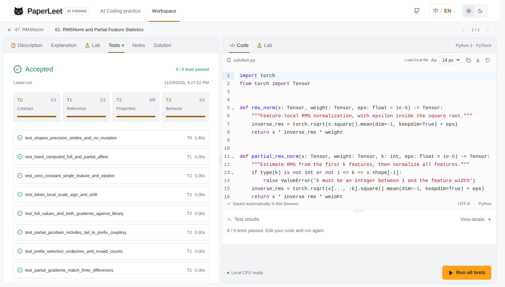
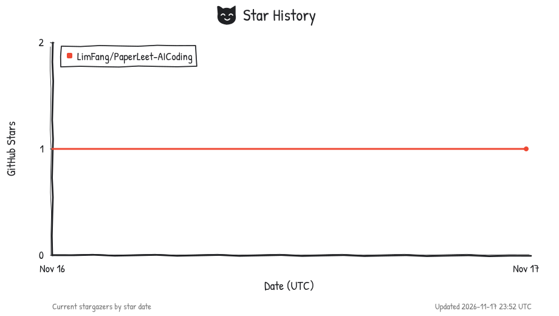

# PaperLeet AI Coding

<picture>
  <source media="(prefers-color-scheme: dark)" srcset="web/public/brand/paperleet-logo-dark.svg">
  
</picture>

**English** | [简体中文](README.zh-CN.md)

**Implement AI methods from papers, practice coding-agent workflows, and verify your code with local tests.**

PaperLeet AI Coding builds on [PaperLeet Offline](https://github.com/Hongyang-Du/PaperLeet). It connects paper-based implementation practice with a curriculum for coding agents, software quality and developer productivity, and agent data and post-training.

**Available now:** the role-oriented homepage, bilingual algorithm exercises, a Python editor, a local CPU judge, and interactive experiments. The [AICB-9 pilot](tasks/aicb9/README.md) adds four local CLI exercises for code tracing, defect diagnosis, test design, and agent-based repository repair. The homepage describes the broader curriculum.

[Quick start](#quick-start) · [First exercise](#first-exercise) · [AICB-9](#aicb-9-pilot) · [Learning paths](#learning-paths) · [Deployment](#deployment) · [Contributing](#contributing)


## Learning paths

| Path | Planned practice | Deliverables |
| --- | --- | --- |
| **Coding Agent engineering** | Model APIs and tool execution; repository retrieval and context selection; bug fixes and cross-file edits; test feedback and task budgets | Patches, execution traces, task success rates and API costs |
| **Quality and developer productivity** | Codebase Q&A with evidence; tests from code changes; root cause analysis with logs and traces; evaluation and failure analysis | Test suites, supporting evidence and evaluation reports |
| **Agent data and post-training** | Trace curation; Agent SFT; outcome and process rewards; RL optimization and ablations | Datasets, training configurations and held-out results |

The target workflow is **understand a task → retrieve context → use tools → change code → run tests → evaluate and improve**. Engineering exercises will use model APIs; training exercises will require separate model and compute setups.

## Available algorithm foundations

The existing library covers LLM training and generation basics, attention and inference, retrieval and recommendation, post-training, reinforcement learning, and additional generative and representation methods. Each exercise supplies a statement, starter, reference implementation, tests, and common mistakes. These foundation exercises run locally without a model API or GPU.

Useful starting points:

- [Next-token loss](problems/foundations/next_token_loss/README.en.md), [SFT loss masking](problems/foundations/sft_loss_mask/README.en.md), and [top-p sampling](problems/foundations/top_p_sampling/README.en.md).
- [Attention](problems/architecture/attention/README.en.md), [RMSNorm](problems/architecture/rms_norm/README.en.md), and [RoPE](problems/architecture/rope/README.en.md).
- [Late-interaction retrieval](problems/retrieval/late_interaction/README.en.md), [LoRA](problems/finetuning/lora/README.en.md), and [DPO](problems/rl/dpo/README.en.md).
- [GAE](problems/rl/gae/README.en.md), [PPO](problems/rl/ppo_clip/README.en.md), and [GRPO](problems/rl/grpo/README.en.md).

The complete catalog and implementation scopes are maintained in [papers.yaml](papers.yaml) and shown in the app. The homepage retains the broader inherited library under **Algorithm foundations**.

## Quick start

Requires **Python 3.10+**, **Node.js 20.19+**, Git, and `make`. Use macOS/Linux, or WSL on Windows. The first dependency installation requires internet access.

```bash
git clone https://github.com/LimFang/PaperLeet-AICoding.git
cd PaperLeet-AICoding
python3 -m venv .venv
source .venv/bin/activate

# Optional on Linux: install CPU-only PyTorch before the project dependencies.
# python -m pip install torch --index-url https://download.pytorch.org/whl/cpu

python -m pip install -e .
npm --prefix web ci
make dev
```

Open **http://127.0.0.1:5173** once `make dev` starts. The command exports the catalog and starts both the frontend and the local Python judge at `127.0.0.1:8765`. Press Ctrl-C to stop both services. For later sessions, activate the environment and run `make dev` again.

For CLI-only practice, install the Python dependencies and skip npm and `make dev`.

## First exercise

Start with RMSNorm. The module asks you to implement RMS normalization and its partial variant, then check both against the contract and reference behavior.

### Web practice

1. After starting `make dev`, open the [RMSNorm workspace](http://127.0.0.1:5173/#/architecture/rms_norm).
2. Read the task and complete the Python starter in the editor.
3. Select **Run all tests** and use the **Tests** tab to review the results by layer.

Use **Load local file** after editing in your IDE. The workspace supports both languages, light and dark themes, resizable panels, and local progress.



### Command-line practice

```bash
source .venv/bin/activate
paperleet list
paperleet init architecture/rms_norm
```

Read the statement and edit `workspace/architecture/rms_norm.py`, then run:

```bash
paperleet test architecture/rms_norm

# Run selected layers while debugging.
paperleet test architecture/rms_norm --layers T0,T2

# Compare with the reference implementation.
paperleet test architecture/rms_norm --impl problems/architecture/rms_norm/solution.py
```

<details>
<summary>Prompt for AI-assisted practice</summary>

> Read the statement and starter. Explain the inputs, outputs and implementation goal before coding. Implement only in workspace/architecture/rms_norm.py; leave the tests unchanged. Run all required tests and explain failures. Read solution.py after the first implementation for comparison.

</details>

## AICB-9 pilot

The terminal exercises cover four engineering tasks. A01, B01, and B03 run without a model API. C01 needs a compatible API for a live run, and the automated checks use a mock model client.

| Task | What you submit | How it is checked |
| --- | --- | --- |
| A01 · Trace the Execution | A structured trace of the TinyCache program | Deterministic scoring against a reference trace |
| B01 · Root Cause Diagnosis | A diagnosis supported by evidence from MiniStore | Deterministic scoring of the cause, evidence, and reasoning |
| B03 · Test the Hidden Bug | A pytest suite for order pagination | The reference must pass, and six code variants measure defect detection |
| C01 · Repository Bug Fix | A repair plan and a patch for TaskFlow | Public tests and a record of tool calls and budget use |

Use `python scripts/aicb9.py --help` to list the commands. [Task instructions and examples](tasks/aicb9/README.md)

### Benchmark protocol and status

The benchmark runner provides S0 Black-box Single-Prompt, S1 White-box Single-Prompt, S2 Tool-Augmented Single-Prompt, and S3 Agentic adapters, subject to each task's declared support in its registry metadata. A01/B01 support S0–S2; C01 supports S3; B03 remains outside the generic runner. Existing deterministic A01/B01 answer evaluation works without a model API. See the [benchmark protocol](docs/benchmark-protocol.md), [evaluation metrics](docs/evaluation-metrics.md), [reproducibility requirements](docs/reproducibility.md), and [scoring rules](docs/scoring-rules.md). The current B03 mutants are public development fixtures, and C01's trusted hidden-test score is not yet available in the local evaluator.

## Validation and evaluation

The current algorithm judge uses four layers:

| Layer | Checks |
| --- | --- |
| **T0 · Contract** | Shapes, types, required outputs, masks and boundaries |
| **T1 · Reference** | Numerical agreement under the stated conventions |
| **T2 · Properties** | Identities, invariances, limiting cases and gradient flow |
| **T3 · Behavior** | Small training, sampling, retrieval or planning experiments |

Required layers vary by exercise. Passing a subset is useful for debugging; completing an exercise requires all required checks. Deliberately buggy implementations in `mutants/` illustrate what the tests catch:

```bash
paperleet mutate architecture/rms_norm
```

## Saving your work

| Location | Contents |
| --- | --- |
| Browser storage | Drafts, feedback, completion and interface preferences |
| `workspace/` | Your local Python implementations |
| `reports/` | Test, experiment and release reports |
| `.paperleet/` | Local judge jobs and source snapshots |

The last three directories are Git-ignored. Your solutions will not be pushed to GitHub automatically. Browser progress is separate for each browser, hostname and port; clearing site data removes browser records. Local judging executes Python with your user's permissions and binds to loopback.

## Deployment

The frontend can be deployed as a static site with Nginx. Hosted pages provide the homepage, exercise content and visualizations. Running Python tests and loading local workspace files require the local app.

Build a release archive:

```bash
bash scripts/package-site.sh
```

The archive is written to `reports/deploy/paperleet-coding-site.tar.gz`. See the [Alibaba Cloud deployment guide](deploy/aliyun/README.md) for Nginx configuration, release directories, rollback and public hosting setup.

The current server deployment is an **SSH-only preview**, with Nginx listening on the server's `127.0.0.1:8080`. No public domain is configured. To open a preview when needed, use your configured SSH alias; this example uses local port **18080**:

```bash
ssh -N -o ExitOnForwardFailure=yes -L 127.0.0.1:18080:127.0.0.1:8080 paperleet-aliyun
```

Open **http://127.0.0.1:18080**. Ctrl-C closes the tunnel and releases the local port; the server continues running. Public hosting requirements are covered in the deployment guide.

## Repository and checks

```text
web/             React + TypeScript homepage, practice UI and labs
problems/        Bilingual algorithm exercises, tests and reference solutions
tasks/aicb9/     Engineering exercises and local evaluation fixtures
papers.yaml      Paper metadata and module order
paperleet/       CLI, local judge and shared helpers
scripts/         Development, release packaging and upstream maintenance
deploy/aliyun/  Nginx templates and deployment guide
sync/            Upstream sync policy and pinned manifests
tests/           Framework, local-service and sync regression checks
```

```bash
make check  # Export the catalog; run framework and frontend checks.
make build  # Export, build and check the static frontend.
make ci     # Also validate reference solutions, mutants and CPU budgets.
```

## GitHub Actions

The repository inherits three workflows. Their current behavior in this fork is:

| Workflow | Status and scope |
| --- | --- |
| [ci.yml](.github/workflows/ci.yml) | **AI Coding checks:** runs `make ci` on main pushes, pull requests, or manual dispatch; uploads `web/dist` as `paperleet-ai-coding-web`. |
| [readme-metrics.yml](.github/workflows/readme-metrics.yml) | Refreshes this fork's Star chart daily at 17:17 UTC, on generator/workflow changes, or by manual dispatch. Runs only on this repository's main branch. |
| [sync-upstream.yml](.github/workflows/sync-upstream.yml) | **Sync algorithm foundations (manual):** imports upstream foundation exercises, runs checks, and opens an update PR for review. Runs only by manual dispatch on this repository's main branch. |

Push the workflow changes to main and enable Actions in GitHub to activate them. To run a curriculum update, select **Sync algorithm foundations (manual) → Run workflow** after reviewing the [allowlist and conflict rules](docs/upstream-sync.md). The repository must allow Actions to create pull requests. There is currently no automatic deployment workflow for the Alibaba Cloud server.

Star updates use the built-in `GITHUB_TOKEN`. The generator rejects snapshots from other repositories; if the first request fails, the chart shows a waiting state until a verified snapshot is available.

## Contributing

Contributions to the new direction can include Agent task specifications, fixture repositories, evaluators, tool adapters, trace analysis and documentation. Mark proposed exercises as planned until they include runnable implementations and validation.

This fork derives its local runtime and foundation exercises from [Hongyang-Du/PaperLeet](https://github.com/Hongyang-Du/PaperLeet), which synchronizes shared curriculum with [PaperLeet/paperleet.github.io](https://github.com/PaperLeet/paperleet.github.io). See [CONTRIBUTING.md](CONTRIBUTING.md) for the inherited curriculum contribution route. Keep paper citations, stable exercise IDs, bilingual content and third-party notices.

## Star history

<picture>
  <source media="(prefers-color-scheme: dark)" srcset="docs/metrics/stars-dark.svg">
  
</picture>

The chart tracks **LimFang/PaperLeet-AICoding**, with daily updates after Actions is enabled. Failed requests retain the last verified snapshot; without one, the chart displays no data. See [metric definitions and refresh behavior](docs/metrics.md).

## License

[MIT](LICENSE). Preserve the original project attribution, exercise sources and third-party notices.
