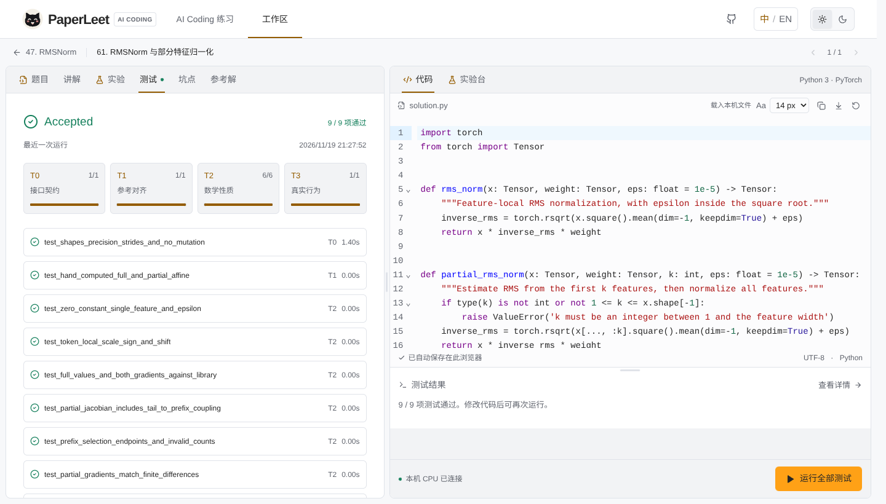
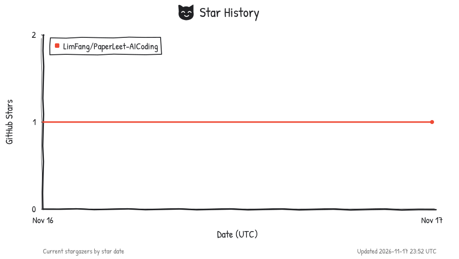

# PaperLeet AI Coding

<picture>
  <source media="(prefers-color-scheme: dark)" srcset="web/public/brand/paperleet-logo-dark.svg">
  
</picture>

[English](README.md) | **简体中文**

**实现论文里的算法，练习 Coding Agent 的工作流程，再用本机测试验证代码。**

PaperLeet AI Coding 基于 [PaperLeet 离线版](https://github.com/Hongyang-Du/PaperLeet)，从论文算法实现出发，建设 Coding Agent 工程、软件质量与研发效能、Agent 数据与后训练三条学习路径。

**当前可用：** 面向岗位的主页、双语算法基础题、Python 编辑器、本机 CPU 判题与交互实验。[AICB-9 试验版](tasks/aicb9/README.md) 提供四道本地命令行练习，覆盖代码轨迹、缺陷诊断、测试设计和 Agent 仓库修复。完整课程规划见主页。

[本地启动](#本地启动) · [第一道练习](#第一道练习) · [AICB-9](#aicb-9-试验版) · [能力路径](#能力路径) · [网站部署](#网站部署) · [参与贡献](#参与贡献)


## 能力路径

| 方向 | 规划中的练习 | 交付物 |
| --- | --- | --- |
| **Coding Agent 工程** | 模型 API 与工具执行；仓库检索与上下文选择；Bug 修复与跨文件修改；测试反馈与任务预算 | 补丁、执行轨迹、任务成功率与 API 成本 |
| **质量智能与研发效能** | 代码库问答与证据引用；基于代码变更生成测试；日志与 Trace 根因分析；任务评测与失败归因 | 测试用例、根因证据与评测报告 |
| **Agent 数据与后训练** | 轨迹清洗；Agent SFT；结果奖励与过程奖励；RL 优化与消融实验 | 数据集、训练配置与独立任务集上的对比结果 |

目标工作流是：**理解任务 → 检索上下文 → 调用工具 → 修改代码 → 运行测试 → 评测与改进**。工程练习将通过模型 API 提供推理能力；训练练习需要单独配置模型和算力。

## 当前可用的算法基础题

现有题库覆盖 LLM 训练与生成基础、注意力与推理、检索推荐、后训练、强化学习，以及生成模型和表征学习等方向。每题提供题面、起始代码、参考解、测试和常见错误。现有基础题在本机执行，无需模型 API 或 GPU。

可以从以下模块开始：

- [下一词预测损失](problems/foundations/next_token_loss/README.md)、[SFT 损失掩码](problems/foundations/sft_loss_mask/README.md)、[Top-p 采样](problems/foundations/top_p_sampling/README.md)。
- [Attention](problems/architecture/attention/README.md)、[RMSNorm](problems/architecture/rms_norm/README.md)、[RoPE](problems/architecture/rope/README.md)。
- [Late Interaction 检索](problems/retrieval/late_interaction/README.md)、[LoRA](problems/finetuning/lora/README.md)、[DPO](problems/rl/dpo/README.md)。
- [GAE](problems/rl/gae/README.md)、[PPO](problems/rl/ppo_clip/README.md)、[GRPO](problems/rl/grpo/README.md)。

完整论文、模块顺序与实现范围以 [papers.yaml](papers.yaml) 和应用中的题库为准。主页将继承的完整题库保留在“算法基础”区域。

## 本地启动

需要 **Python 3.10+**、**Node.js 20.19+**、Git 和 `make`。支持 macOS/Linux；Windows 可使用 WSL。首次安装依赖需要联网。

```bash
git clone https://github.com/LimFang/PaperLeet-AICoding.git
cd PaperLeet-AICoding
python3 -m venv .venv
source .venv/bin/activate

# Linux 可选：在项目依赖之前安装 CPU-only PyTorch。
# python -m pip install torch --index-url https://download.pytorch.org/whl/cpu

python -m pip install -e .
npm --prefix web ci
make dev
```

`make dev` 启动后，打开 **http://127.0.0.1:5173**。这条命令会导出题库，并启动前端与监听 `127.0.0.1:8765` 的本机 Python 判题服务。按 Ctrl-C 可同时停止两项服务。下次使用时激活虚拟环境，再运行 `make dev`。

只使用命令行做题时，安装 Python 依赖即可，跳过 npm 和 `make dev`。

## 第一道练习

可以从 RMSNorm 开始。目标是实现 RMSNorm 和部分 RMSNorm，再用接口契约和参考结果检查实现。

### 网页练习

1. 运行 `make dev` 后打开 [RMSNorm 工作区](http://127.0.0.1:5173/#/architecture/rms_norm)。
2. 阅读题目要求，在编辑器中补全 Python 起始代码。
3. 点击 **运行全部测试**，在 **测试** 页签查看各层结果。

在 IDE 中修改后，可以点击 **载入本机文件** 将代码读回网页。工作区支持中英文、浅色和深色主题、面板拖动以及本地学习进度。



### 命令行练习

```bash
source .venv/bin/activate
paperleet list
paperleet init architecture/rms_norm
```

阅读题面，编辑 `workspace/architecture/rms_norm.py`，然后运行：

```bash
paperleet test architecture/rms_norm

# 调试时只运行指定层。
paperleet test architecture/rms_norm --layers T0,T2

# 对照参考实现。
paperleet test architecture/rms_norm --impl problems/architecture/rms_norm/solution.py
```

<details>
<summary>AI 辅助练习提示词</summary>

> 阅读题面和 starter，先解释输入、输出和实现目标。只修改 workspace/architecture/rms_norm.py，保留判题测试。完成后运行全部必需测试并解释失败原因。首次实现后，再阅读 solution.py 对照分析。

</details>

## AICB-9 试验版

四道工程练习都从命令行运行。A01、B01 和 B03 无需模型 API。C01 接入真实模型时需要兼容 API，自动化检查使用模拟模型客户端。

| 任务 | 提交内容 | 评测方式 |
| --- | --- | --- |
| A01 · 执行轨迹 | TinyCache 程序的结构化执行轨迹 | 按参考轨迹确定性评分 |
| B01 · 根因诊断 | 带 MiniStore 代码证据的根因分析 | 按根因、证据和推理过程确定性评分 |
| B03 · 测试设计 | 针对订单分页的 pytest 测试 | 先通过参考实现，再用六个代码变异体检验测试能否发现缺陷 |
| C01 · 仓库修复 | TaskFlow 的修复计划和补丁 | 运行公开测试，记录工具调用和预算用量 |

运行 `python scripts/aicb9.py --help` 查看可用命令。[题目说明与运行示例](tasks/aicb9/README.md)

### Benchmark 协议与当前状态

AICB-9 正在先行明确 Benchmark 协议，之后再实现统一实验执行器。协议定义了四种对照策略：S0 Black-box Single-Prompt、S1 White-box Single-Prompt、S2 Tool-Augmented Single-Prompt 和 S3 Agentic。统一 Runner 已提供 S0 Black-box Single-Prompt、S1 White-box Single-Prompt、S2 Tool-Augmented Single-Prompt 和 S3 Agentic 适配器，但具体题目能运行哪些策略以任务注册表为准：A01/B01 支持 S0–S2，C01 支持 S3，B03 暂未接入统一 Runner。A01/B01 已有答案的确定性评分无需模型 API。详见 [Benchmark 协议](docs/benchmark-protocol.md)、[评测指标](docs/evaluation-metrics.md)、[可复现性要求](docs/reproducibility.md) 和 [评分规则](docs/scoring-rules.md)。当前 B03 的 Mutants 是公开的开发样例；C01 的可信隐藏测试分数尚未由本地评测器实现。

## 验证与评测

现有算法判题采用四层检查：

| 层级 | 检查内容 |
| --- | --- |
| **T0 · 接口契约** | 形状、类型、必需输出、mask 与边界输入 |
| **T1 · 参考对齐** | 在题目约定下与参考结果数值对齐 |
| **T2 · 数学性质** | 恒等式、不变性、极限情形与梯度流 |
| **T3 · 真实行为** | 小型训练、采样、检索或规划实验 |

各题按需设置必需层级。只运行部分测试适合调试，通过全部必需检查才算完成。`mutants/` 中的刻意错误实现展示测试如何发现问题：

```bash
paperleet mutate architecture/rms_norm
```

## 保存代码与进度

| 位置 | 内容 |
| --- | --- |
| 浏览器存储 | 编辑器草稿、反馈、通过状态与界面偏好 |
| `workspace/` | 自己的本机 Python 实现 |
| `reports/` | 测试、实验和发布报告 |
| `.paperleet/` | 本机判题任务与源码快照 |

后三个目录被 Git 忽略，解答不会自动提交到 GitHub。不同浏览器、主机名和端口各自保存进度；清理网站数据会删除浏览器记录。本机判题以当前用户权限执行 Python，仅监听回环地址。

## 网站部署

前端可通过 Nginx 部署为静态网站，提供主页、题库内容和实验可视化。运行 Python 测试、读取本机工作区文件仍需使用本地应用。

生成发布包：

```bash
bash scripts/package-site.sh
```

产物位于 `reports/deploy/paperleet-coding-site.tar.gz`。Nginx 配置、版本目录、回滚及公网部署准备见[阿里云部署说明](deploy/aliyun/README.md)。

当前云服务器采用 **SSH 预览模式**，Nginx 监听服务器的 `127.0.0.1:8080`，尚未配置公网域名。需要预览时，使用已配置的 SSH 别名建立隧道；以下示例使用本机 **18080** 端口：

```bash
ssh -N -o ExitOnForwardFailure=yes -L 127.0.0.1:18080:127.0.0.1:8080 paperleet-aliyun
```

打开 **http://127.0.0.1:18080**。Ctrl-C 关闭隧道并释放本机端口，服务器站点继续运行。公网访问所需的配置和备案说明见部署文档。

## 目录与检查

```text
web/             React + TypeScript 主页、做题界面与实验
problems/        双语算法题、测试与参考解
tasks/aicb9/     工程练习与本地评测样例
papers.yaml      论文信息与模块顺序
paperleet/       CLI、本机判题与公共辅助代码
scripts/         开发启动、发布打包与上游维护脚本
deploy/aliyun/   Nginx 模板与部署说明
sync/            上游同步策略与固定版本清单
tests/           框架、本机服务和同步回归检查
```

```bash
make check  # 导出题库，运行框架和前端检查。
make build  # 导出、构建并检查静态前端。
make ci     # 额外验证参考解、错误实现和 CPU 预算。
```

## GitHub Actions

仓库继承了三个工作流，在当前 fork 中的实际状态如下：

| 工作流 | 当前行为与范围 |
| --- | --- |
| [ci.yml](.github/workflows/ci.yml) | **AI Coding checks：** main 推送、PR 或手动触发时执行 `make ci`，将 `web/dist` 上传为 `paperleet-ai-coding-web`。 |
| [readme-metrics.yml](.github/workflows/readme-metrics.yml) | 每日 UTC 17:17（北京时间次日 01:17）、生成器或工作流变更、手动触发时更新本 fork 的 Star 图表；仅在本仓库 main 分支运行。 |
| [sync-upstream.yml](.github/workflows/sync-upstream.yml) | **Sync algorithm foundations (manual)：** 手动导入上游基础题，检查通过后创建更新 PR，供维护者审核；仅允许在本仓库 main 分支手动触发。 |

将工作流改动推送到 main，并在 GitHub 中启用 Actions 后生效。更新题库前先确认[白名单与冲突处理规则](docs/upstream-sync.md)，再选择 **Sync algorithm foundations (manual) → Run workflow**；仓库需允许 Actions 创建 PR。当前没有自动部署到阿里云的工作流。

Star 更新使用内置 `GITHUB_TOKEN`。生成器会拒绝其他仓库的缓存；首次请求失败时，图表显示等待数据，直到获得可验证的快照。

## 参与贡献

欢迎补充新方向的 Agent 任务规格、小型代码仓库、评测器、工具适配、轨迹分析和文档。新增练习在具备可运行实现与验证之前，应标为规划中。

本项目的本机运行框架和算法基础题源于 [Hongyang-Du/PaperLeet](https://github.com/Hongyang-Du/PaperLeet)，共享题库由其与 [PaperLeet/paperleet.github.io](https://github.com/PaperLeet/paperleet.github.io) 同步。继承题库的贡献入口见 [CONTRIBUTING.md](CONTRIBUTING.md)。请保留论文来源、稳定练习 ID、双语内容和第三方声明。

## Star 曲线

<picture>
  <source media="(prefers-color-scheme: dark)" srcset="docs/metrics/stars-dark.svg">
  
</picture>

图表统计 **LimFang/PaperLeet-AICoding**，启用 Actions 后每日更新。请求失败时保留上次验证过的数据；没有有效快照时展示无数据状态。[数据口径与刷新机制](docs/metrics.md)。

## 许可证

采用 [MIT 许可证](LICENSE)。请保留原项目署名、题目来源与第三方声明。
